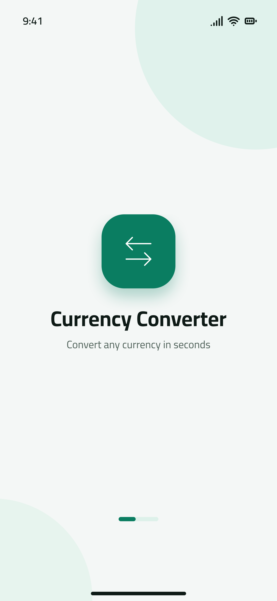
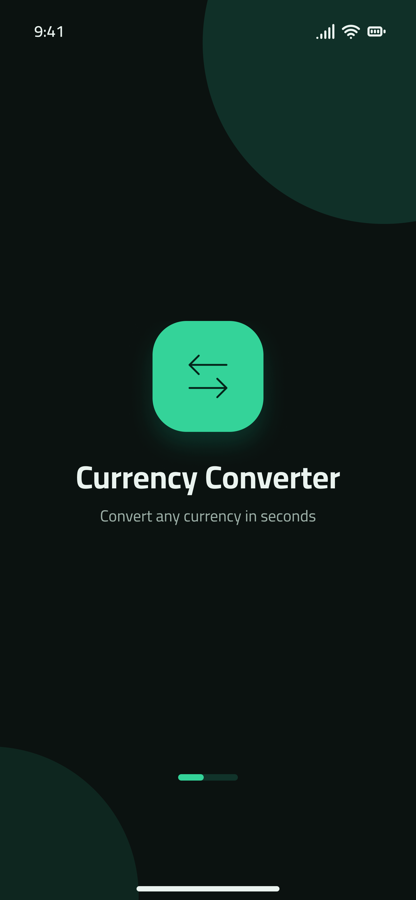
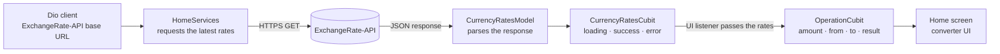
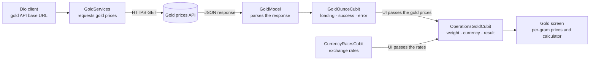

<div align="center">

<picture>
  <source media="(prefers-color-scheme: dark)" srcset="assets/images/splash_screen_dark.png">
  
</picture>

# Sarraf | صرّاف

**محوّل عملات سريع وثنائي اللغة مع أسعار الذهب لأندرويد و iOS، مبني بـ Flutter.**

تحويل العملات &nbsp;·&nbsp; أسعار الذهب &nbsp;·&nbsp; العربية والإنجليزية &nbsp;·&nbsp; وضع فاتح وداكن

<p>
  <a href="https://flutter.dev"></a>
  <a href="https://dart.dev"></a>
  
  
  
</p>

[English](README.md) &nbsp;|&nbsp; **العربية**

<sub>
<a href="#نظرة-عامة">نظرة عامة</a> ·
<a href="#المميزات">المميزات</a> ·
<a href="#لقطات-الشاشة">لقطات الشاشة</a> ·
<a href="#التقنيات-المستخدمة">التقنيات</a> ·
<a href="#هيكلية-المشروع">هيكلية المشروع</a> ·
<a href="#مصادر-البيانات">مصادر البيانات</a> ·
<a href="#البدء-السريع">البدء السريع</a> ·
<a href="#خارطة-الطريق">خارطة الطريق</a> ·
<a href="#حقوق-النشر-وقيود-الاستخدام">الحقوق</a>
</sub>

</div>

---

<div dir="rtl">

## نظرة عامة

**صرّاف (Sarraf)** تطبيق جوّال مبني بـ Flutter يقدّم أداتين:

1. **محوّل العملات:** اختر العملة المصدر والعملة المستهدفة، وأدخل المبلغ، فتظهر القيمة المحوّلة أثناء الكتابة بناءً على أحدث الأسعار المتاحة من [ExchangeRate-API](https://www.exchangerate-api.com/).
2. **أسعار الذهب:** اعرض سعر الجرام لعيارات 24 و22 و21 و18 بالعملة التي تختارها، وقدّر قيمة وزن معيّن من ذهب عيار 21.

التطبيق ثنائي اللغة بين **الإنجليزية (`en-US`)** و**العربية (`ar-EG`)**، ويأتي بوضعين فاتح وداكن، ويمكن تغيير اللغة والمظهر من شاشة الإعدادات.

## المميزات

|     | الميزة                 | التفاصيل                                                                                                                 |
| :-: | ---------------------- | ------------------------------------------------------------------------------------------------------------------------ |
| 💱  | **محوّل العملات**      | تحويل بين أكثر من 160 عملة. تتحدّث النتيجة أثناء الكتابة، ويعكس زر التبديل زوج العملتين.                                 |
| 📈  | **أسعار الصرف**        | تُجلب الأسعار من ExchangeRate-API عند تشغيل التطبيق، وتكون بحداثة آخر تحديث لدى المزوّد.                                 |
| 🥇  | **أسعار الذهب**        | سعر الجرام لعيارات 24 و22 و21 و18، بأي عملة مدعومة.                                                                      |
| 🧮  | **حاسبة الذهب**        | أدخل الوزن بالجرام لتقدير قيمة ذهب عيار 21 بالعملة المختارة.                                                             |
| ⏳  | **التحميل والأخطاء**   | مؤشر تحميل للأسعار وعناصر Shimmer لأسعار الذهب. نافذة خطأ مع إعادة المحاولة لأسعار الصرف، وزر إعادة محاولة لأسعار الذهب. |
| 🌍  | **واجهة ثنائية اللغة** | الإنجليزية (`en-US`) والعربية (`ar-EG`) عبر `easy_localization`.                                                         |
| 🎨  | **وضع فاتح وداكن**     | التحكم في المظهر واللغة من شاشة إعدادات مخصصة.                                                                           |
| 📱  | **تصميم متجاوب**       | يتكيف مع مقاسات الشاشات المختلفة عبر `flutter_screenutil_plus`.                                                          |
| 🚀  | **هوية جاهزة للمنصات** | أيقونات مخصصة لأندرويد و iOS، وشاشات تشغيل للوضع الفاتح والداكن وأندرويد 12 وما بعده.                                    |
| 🛠️  | **مناسب للمطوّرين**    | تسجيل طلبات الشبكة في وضع التطوير عبر `pretty_dio_logger`.                                                               |

## لقطات الشاشة

<div align="center">

|                                   شاشة التشغيل الفاتحة                                   |                                  شاشة التشغيل الداكنة                                   |
| :--------------------------------------------------------------------------------------: | :-------------------------------------------------------------------------------------: |
|  |  |

</div>

<!--
لقطات التطبيق: أضف صورًا حقيقية في docs/screenshots/ ثم فعّل هذا الجزء بإزالة علامات التعليق.

<div align="center">

| المحوّل (EN) | المحوّل (AR) | أسعار الذهب | الوضع الداكن | الإعدادات |
|:-:|:-:|:-:|:-:|:-:|
|  |  |  |  |  |

</div>
-->

## التقنيات المستخدمة

| المجال                 | التقنية                                            | الاستخدام                                                               |
| ---------------------- | -------------------------------------------------- | ----------------------------------------------------------------------- |
| الإطار                 | Flutter                                            | واجهات متعددة المنصات لأندرويد و iOS                                    |
| اللغة                  | Dart                                               | منطق التطبيق                                                            |
| الشبكة                 | Dio, `pretty_dio_logger`                           | عملاء HTTP، وتسجيل الطلبات في وضع التطوير                               |
| مصادر البيانات         | ExchangeRate-API (v6)، وواجهة egypt-gold-price.com | أسعار الصرف وأسعار الذهب                                                |
| إدارة الحالة           | `flutter_bloc` / `bloc`                            | Cubits لأسعار الصرف والتحويل وأسعار الذهب وحاسبة الذهب والمظهر          |
| الترجمة                | `easy_localization`                                | نصوص الإنجليزية (`en-US`) والعربية (`ar-EG`)، وتنسيق الأرقام عبر `intl` |
| التصميم المتجاوب       | `flutter_screenutil_plus`                          | أحجام تتكيف مع الشاشة                                                   |
| الخطوط                 | `google_fonts`                                     | خط Cairo                                                                |
| الرسومات               | `flutter_svg`                                      | عرض ملفات SVG                                                           |
| واجهات التغذية الراجعة | `awesome_dialog`, `shimmer`                        | نافذة الخطأ وعناصر التحميل                                              |
| شاشات التشغيل          | `flutter_native_splash`                            | إعداد شاشة التشغيل للوضع الفاتح والداكن وأندرويد 12 وما بعده            |

## هيكلية المشروع

يعتمد المشروع على هيكلية قائمة على الميزات (Feature-based): البنية المشتركة داخل `core/`، وكل ميزة تمتلك بياناتها ومنطقها وواجهتها.

<div dir="ltr">

```text
lib/
├── core/
│   ├── Network/
│   ├── constants/
│   ├── helpers/
│   ├── models/
│   ├── routing/
│   ├── theming/
│   └── widgets/
├── feature/
│   ├── home/
│   │   ├── data/
│   │   ├── logic/
│   │   └── ui/
│   ├── gold/
│   │   ├── data/
│   │   ├── logic/
│   │   └── ui/
│   └── settings/
│       ├── logic/
│       └── ui/
├── main.dart
└── sarraf_app.dart

assets/
├── images/
├── svgs/
└── translations/
```

</div>

| المسار              | المسؤولية                                                                                 |
| ------------------- | ----------------------------------------------------------------------------------------- |
| `core/Network/`     | عملاء Dio لواجهتي أسعار الصرف والذهب                                                      |
| `core/constants/`   | عناوين الـ API ونقاط النهاية                                                              |
| `core/helpers/`     | مساعدات التخطيط المشتركة                                                                  |
| `core/models/`      | النماذج المشتركة (كتالوج العملات)                                                         |
| `core/routing/`     | مسارات التطبيق                                                                            |
| `core/theming/`     | الألوان والخطوط والثيمات                                                                  |
| `core/widgets/`     | عناصر واجهة مشتركة (حقل العملة، وحقل الإدخال الرقمي)                                      |
| `feature/home/`     | نموذج أسعار الصرف وخدمة الـ API، وCubits جلب الأسعار وحالة التحويل، وشاشة المحوّل         |
| `feature/gold/`     | نماذج الذهب وقائمة العيارات وخدمة الـ API، وCubits جلب الأسعار وحالة الحاسبة، وشاشة الذهب |
| `feature/settings/` | إدارة حالة المظهر وشاشة الإعدادات                                                         |
| `main.dart`         | نقطة بداية التطبيق وتزويد الـ Cubits                                                      |
| `assets/`           | الصور وملفات SVG وملفات الترجمة                                                           |

### إدارة الحالة

تُزوَّد كل الـ Cubits على مستوى التطبيق في `main.dart`.

| الـ Cubit             | المسؤولية                                                                               |
| --------------------- | --------------------------------------------------------------------------------------- |
| `CurrencyRatesCubit`  | جلب أسعار الصرف (ابتدائية، تحميل، نجاح، خطأ).                                           |
| `OperationCubit`      | يحمل المبلغ والعملتين المصدر والمستهدفة والنتيجة المحوّلة، ويتولى التبديل بين العملتين. |
| `GoldOunceCubit`      | جلب أسعار الذهب (ابتدائية، تحميل، نجاح، خطأ).                                           |
| `OperationsGoldCubit` | يحمل الوزن والعملة المختارة، ويحسب قيمة الذهب وسعر الجرام لكل عيار.                     |
| `ThemeCubit`          | يحمل وضع المظهر المختار.                                                                |

### مسار البيانات

تحويل العملات:

<div dir="ltr">



</div>

أسعار الذهب:

<div dir="ltr">



</div>

الطلبان الافتراضيان مكافئان لـ:

<div dir="ltr">

```text
GET https://v6.exchangerate-api.com/v6/<API_KEY>/latest/USD
GET https://www.egypt-gold-price.com/api/prices.php
```

</div>

### طريقة حساب أسعار الذهب

لعيار `K` وللعملة المختارة، يُحسب سعر الجرام هكذا:

<div dir="ltr">

```text
price per gram = (gold ounce price in USD ÷ 31.1035) × (K ÷ 24) × (USD → selected currency rate)
```

</div>

القيمة `31.1035` هي عدد الجرامات في الأوقية التروية (Troy ounce). تضرب الحاسبة سعر الجرام لعيار 21 في الوزن الذي تدخله. ويُستخدم من استجابة واجهة الذهب سعر الأوقية بالدولار فقط.

> **ملاحظة:** هذه القيم تقديرية مشتقة من سعر الأوقية؛ فلا تشمل المصنعية ولا الضرائب ولا هوامش التجار، وقد تختلف عن الأسعار التي يعرضها الصاغة.

## مصادر البيانات

| البيانات    | المزوّد                                                         | ملاحظات                                                |
| ----------- | --------------------------------------------------------------- | ------------------------------------------------------ |
| أسعار الصرف | [ExchangeRate-API](https://www.exchangerate-api.com/) (v6)      | يتطلب مفتاح API. الأسعار بحداثة آخر تحديث لدى المزوّد. |
| أسعار الذهب | واجهة [egypt-gold-price.com](https://www.egypt-gold-price.com/) | يستدعيها التطبيق دون مفتاح API.                        |

> **ملاحظة:** أسعار الصرف وقيم الذهب المعروضة في التطبيق تقديرات استرشادية، وليست نصيحة مالية، وقد تختلف عن أسعار البنوك ومكاتب الصرافة والصاغة. البيانات مصدرها جهات خارجية، لذا تعتمد إتاحتها ودقتها وشروط استخدامها على تلك الجهات.

## البدء السريع

### المتطلبات

- Flutter SDK مع Dart بإصدار `3.13.1` أو أحدث (راجع القيد المحدد في `pubspec.yaml`).
- Android Studio مع Android SDK لبناء نسخة أندرويد.
- Xcode و CocoaPods لبناء نسخة iOS (على macOS فقط).
- مفتاح صالح من [ExchangeRate-API](https://www.exchangerate-api.com/). واجهة الذهب التي يستخدمها التطبيق لا تحتاج مفتاحًا.

تحقق من إعداد Flutter على جهازك:

<div dir="ltr">

```bash
flutter doctor
```

</div>

### 1. استنساخ المشروع

<div dir="ltr">

```bash
git clone https://github.com/Amr4924/Sarraf.git
cd Sarraf
```

</div>

### 2. تثبيت الحزم

<div dir="ltr">

```bash
flutter pub get
```

</div>

### 3. إعداد الـ API

إعدادات الـ API موجودة في الملفين:

<div dir="ltr">

```text
lib/core/constants/api_constants.dart    # عناوين أسعار الصرف وأسعار الذهب
lib/core/constants/api_endpoint.dart     # نقاط النهاية: العملة الأساسية ومسار أسعار الذهب
```

</div>

استبدل جزء المفتاح داخل `rateBaseUrl` بمفتاح ExchangeRate-API الخاص بك:

<div dir="ltr">

```dart
class ApiConstants {
  static final String rateBaseUrl =
      "https://v6.exchangerate-api.com/v6/<YOUR_API_KEY>/latest/";
  static final String goldBaseUrl = "https://www.egypt-gold-price.com/api/";
}
```

</div>

يستخدم طلب الأسعار المسار `latest/USD`، ويستدعي طلب الذهب `prices.php`.

> **تنبيه أمني:** مفاتيح الـ API المضمّنة داخل تطبيقات الجوّال يمكن استخراجها من ملف APK أو IPA بعد البناء. في بيئة الإنتاج، قيّد المفتاح من لوحة تحكم المزوّد أو مرّر الطلبات عبر خادم وسيط آمن، ولا تضع مفتاحًا خاصًا أو غير مقيّد في مستودع عام.

### 4. التشغيل

<div dir="ltr">

```bash
flutter run
```

</div>

للتشغيل على جهاز محدد:

<div dir="ltr">

```bash
flutter devices
flutter run -d <device-id>
```

</div>

## بناء نسخة الإصدار

| المنصة  | الأمر                         | ملاحظات                                                                                                                                        |
| ------- | ----------------------------- | ---------------------------------------------------------------------------------------------------------------------------------------------- |
| أندرويد | `flutter build apk --release` | الناتج: `build/app/outputs/flutter-apk/app-release.apk`. ملف الـ manifest الخاص بنسخة الإصدار يتضمن صلاحية الإنترنت المطلوبة لواجهات البيانات. |
| iOS     | `flutter build ios --release` | على macOS فقط. قبل النشر على App Store اضبط التوقيع ومعرّفات الحزمة والشهادات وملفات Provisioning في Xcode.                                    |

## فحوصات الجودة

تنسيق الملفات، ثم التحليل الثابت:

<div dir="ltr">

```bash
dart format .
flutter analyze
```

</div>

> **ملاحظة:** لا يزال المستودع يحتوي على اختبار القالب الافتراضي من Flutter، وهو لا يطابق هذا التطبيق. استبداله باختبارات حقيقية ضمن [خارطة الطريق](#خارطة-الطريق)، ولذلك لا يظهر الأمر `flutter test` هنا بعد.

## اللغات والترجمة

ملفات الترجمة موجودة في:

<div dir="ltr">

```text
assets/translations/en-US.json
assets/translations/ar-EG.json
```

</div>

عند إضافة نص جديد:

1. أضف المفتاح في **كلا** ملفي الترجمة.
2. استخدم المفتاح نفسه في الـ Widget عبر `tr(...)`.
3. تحقق من اللغتين من شاشة الإعدادات.

## قيود حالية

- يتطلب التطبيق اتصالًا بالإنترنت؛ فلا يوجد تخزين مؤقت لأسعار الصرف والذهب بعد.
- تحسب حاسبة الذهب قيمة عيار 21 فقط.
- لا يُحفظ المظهر المختار بين مرات التشغيل.

## خارطة الطريق

**تم إنجازه**

- [x] أسعار صرف من ExchangeRate-API، والتحويل بين أي عملتين
- [x] التحويل أثناء الكتابة مع زر لتبديل العملتين
- [x] حالات تحميل وخطأ مع إعادة المحاولة لأسعار الصرف وأسعار الذهب
- [x] أسعار الذهب لكل عيار، وحاسبة لقيمة الذهب
- [x] إدارة الحالة عبر Cubits في جميع الميزات
- [x] دعم الإنجليزية والعربية
- [x] وضع فاتح وداكن مع شاشة إعدادات
- [x] أيقونات وشاشات تشغيل لأندرويد و iOS

**القادم**

- [ ] نقل بيانات اعتماد الـ API إلى إعداد أكثر أمانًا وقت التشغيل أو إلى خادم وسيط
- [ ] اختبارات وحدة لتحليل الاستجابة وحسابات التحويل والذهب
- [ ] اختبارات Widget لاختيار العملة والإدخال وتغيير المظهر
- [ ] تخزين مؤقت لآخر أسعار الصرف والذهب المحمّلة للاستخدام دون اتصال
- [ ] عرض وقت آخر تحديث لدى المزوّد لأسعار الصرف والذهب
- [ ] اختيار العيار في حاسبة الذهب
- [ ] حفظ المظهر المختار بين مرات التشغيل
- [ ] بحث داخل قائمة اختيار العملة

## سير العمل في التطوير

> هذا المستودع ملكية خاصة. راجع [حقوق النشر وقيود الاستخدام](#حقوق-النشر-وقيود-الاستخدام) قبل مشاركة أي جزء منه أو إعادة استخدامه.

1. أنشئ فرعًا مخصصًا من `development`: `git switch -c feature/<short-description>` (أو `fix/…` أو `refactor/…`).
2. اجعل التغييرات محدودة النطاق والتزم بهيكلية الميزات الحالية.
3. شغّل `dart format .` و `flutter analyze`، وجرّب المسارات المتأثرة باللغتين وبالمظهرين.
4. اكتب رسالة commit واضحة وفق [Conventional Commits](https://www.conventionalcommits.org/)، مثل `feat(gold): add karat selection`.
5. افتح Pull Request إلى `development` مع خطوات التحقق ولقطات شاشة لتغييرات الواجهة. تُرقّى التغييرات من `development` إلى `staging` ثم إلى `master`.

## حقوق النشر وقيود الاستخدام

Copyright (c) 2026 Amr Saad. جميع الحقوق محفوظة.

صرّاف (Sarraf)، بما في ذلك شيفرته المصدرية واسم التطبيق وهويته البصرية وتصاميمه وواجهته وأيقوناته وصوره وترجماته وتوثيقه وأي أصول أخرى مضمّنة فيه، عمل مملوك ملكية خاصة لصاحب حقوق النشر.

هذا المستودع **ليس مفتوح المصدر** و**غير مرخّص للاستخدام التجاري**. لا يجوز لأي شخص أو جهة، دون إذن كتابي مسبق من صاحب حقوق النشر:

- استخدام المشروع أو أي جزء منه لأغراض تجارية؛
- نسخه أو إعادة إنتاجه أو تعديله أو تكييفه أو إنشاء أعمال مشتقة منه؛
- نشره أو إعادة توزيعه أو منح تراخيص فرعية له أو بيعه أو تضمينه في منتج آخر؛
- استخدام اسم Sarraf أو علامته أو أيقوناته أو تصاميمه أو أصوله؛
- استخدام الشيفرة المصدرية أو الأصول في خدمة أو تطبيق أو منتج مدفوع.

يُسمح بالاستخدام الشخصي والتعليمي وأغراض التقييم الداخلي فقط مع الإشارة المناسبة إلى المصدر، وبشرط ألا يتضمن ذلك توزيعًا تجاريًا أو تحقيق ربح. لا ينقل هذا الإذن الملكية ولا يمنح أي ترخيص بنشر المشروع أو إعادة توزيعه.

لأي استخدام تجاري، أو إعادة توزيع، أو شراكة، أو طلب ترخيص، أو أي إذن آخر، تواصل مع صاحب حقوق النشر واحصل على موافقة كتابية صريحة قبل استخدام المشروع:

- **صاحب حقوق النشر:** Amr Saad ([@Amr4924](https://github.com/Amr4924))
- **الإذن مطلوب:** نعم، لأي استخدام تجاري أو إعادة توزيع

لا تُمنح أي حقوق إلا ما نُصّ عليه صراحةً أعلاه.

> **ملاحظة:** هذه الفقرة ترجمة للتسهيل. عند وجود أي اختلاف يُعتمد النص الإنجليزي في [README.md](README.md#copyright-and-usage-restrictions).

</div>

---

<div align="center">
  <sub>مبني بـ Flutter لتحويل العملات والاطلاع على أسعار الذهب بسرعة وبساطة.</sub>
</div>
