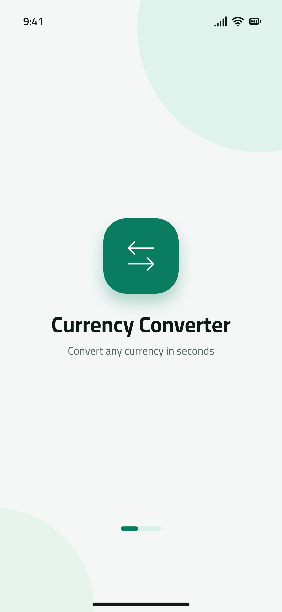
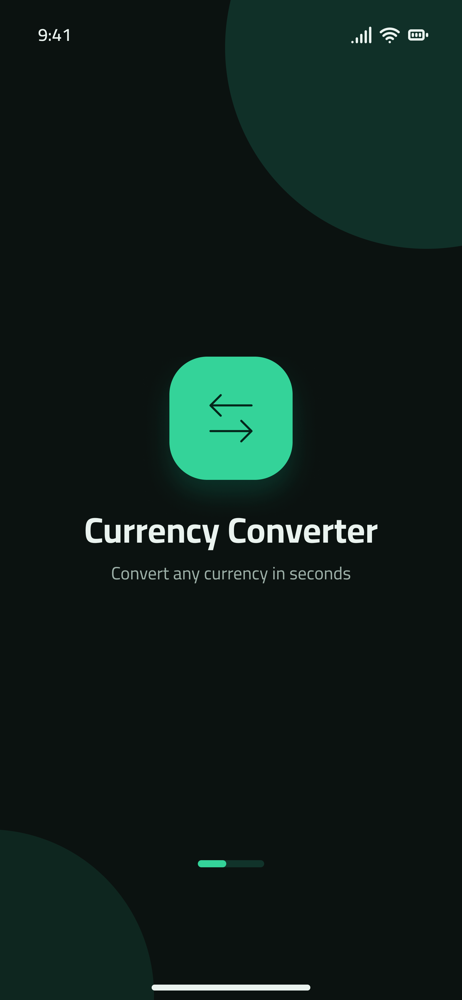
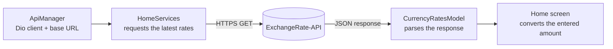

<div align="center">

<picture>
  <source media="(prefers-color-scheme: dark)" srcset="assets/images/splash_screen_dark.png">
  
</picture>

# Sarraf | صرّاف

**محوّل عملات سريع وثنائي اللغة لأندرويد و iOS، مبني بـ Flutter.**

أسعار صرف مباشرة &nbsp;·&nbsp; العربية والإنجليزية &nbsp;·&nbsp; وضع فاتح وداكن

<p>
  <a href="https://flutter.dev"></a>
  <a href="https://dart.dev"></a>
  
  
  
</p>

[English](README.md) &nbsp;|&nbsp; **العربية**

<sub>
<a href="#نظرة-عامة">نظرة عامة</a> ·
<a href="#المميزات">المميزات</a> ·
<a href="#لقطات-الشاشة">لقطات الشاشة</a> ·
<a href="#التقنيات-المستخدمة">التقنيات</a> ·
<a href="#هيكلية-المشروع">هيكلية المشروع</a> ·
<a href="#البدء-السريع">البدء السريع</a> ·
<a href="#خارطة-الطريق">خارطة الطريق</a> ·
<a href="#حقوق-النشر-وقيود-الاستخدام">الحقوق</a>
</sub>

</div>

---

<div dir="rtl">

## نظرة عامة

**صرّاف (Sarraf)** تطبيق جوّال مبني بـ Flutter لتحويل العملات باستخدام [ExchangeRate-API](https://www.exchangerate-api.com/). تدور فكرته حول مسار واحد واضح:

1. اختر العملة المصدر والعملة المستهدفة.
2. أدخل المبلغ.
3. احصل على القيمة المحوّلة بناءً على أحدث الأسعار المتاحة.

التطبيق ثنائي اللغة بين **الإنجليزية (`en-US`)** و**العربية (`ar-EG`)**، ويأتي بوضعين فاتح وداكن، ويمكن تغيير اللغة والمظهر من شاشة الإعدادات.

## المميزات

| | الميزة | التفاصيل |
|:-:|---|---|
| 💱 | **أسعار صرف مباشرة** | أحدث الأسعار من ExchangeRate-API. |
| 🔁 | **تحويل فوري** | اختر العملة المصدر والمستهدفة، أدخل المبلغ، واحصل على النتيجة. |
| 🪙 | **كتالوج عملات واسع** | أسماء العملات وأكوادها ورموزها. |
| 🌍 | **واجهة ثنائية اللغة** | الإنجليزية (`en-US`) والعربية (`ar-EG`) عبر `easy_localization`. |
| 🎨 | **وضع فاتح وداكن** | التحكم في المظهر واللغة من شاشة إعدادات مخصصة. |
| 📱 | **تصميم متجاوب** | يتكيف مع مقاسات الشاشات المختلفة عبر `flutter_screenutil_plus`. |
| 🚀 | **هوية جاهزة للمنصات** | أيقونات مخصصة لأندرويد و iOS، وشاشات تشغيل للوضع الفاتح والداكن وأندرويد 12 وما بعده. |
| 🛠️ | **مناسب للمطوّرين** | تسجيل طلبات الشبكة في وضع التطوير عبر `pretty_dio_logger`. |

## لقطات الشاشة

<div align="center">

| شاشة التشغيل الفاتحة | شاشة التشغيل الداكنة |
|:---:|:---:|
|  |  |

</div>

<!--
لقطات التطبيق: أضف صورًا حقيقية في docs/screenshots/ ثم فعّل هذا الجزء بإزالة علامات التعليق.

<div align="center">

| المحوّل (EN) | المحوّل (AR) | الوضع الداكن | الإعدادات |
|:-:|:-:|:-:|:-:|
|  |  |  |  |

</div>
-->

## التقنيات المستخدمة

| المجال | التقنية | الاستخدام |
|---|---|---|
| الإطار | Flutter | واجهات متعددة المنصات لأندرويد و iOS |
| اللغة | Dart | منطق التطبيق |
| الشبكة | Dio, `pretty_dio_logger` | عميل HTTP، وتسجيل الطلبات في وضع التطوير |
| مصدر البيانات | ExchangeRate-API (v6) | أحدث أسعار الصرف |
| الحالة والمظهر | `flutter_bloc` / `bloc` | إدارة الحالة، ومنها حالة المظهر في ميزة الإعدادات |
| الترجمة | `easy_localization` | نصوص الإنجليزية (`en-US`) والعربية (`ar-EG`) |
| التصميم المتجاوب | `flutter_screenutil_plus` | أحجام تتكيف مع الشاشة |
| الرسومات | `flutter_svg` | عرض ملفات SVG |
| شاشات التشغيل | `flutter_native_splash` | إعداد شاشة التشغيل للوضع الفاتح والداكن وأندرويد 12 وما بعده |

## هيكلية المشروع

يعتمد المشروع على هيكلية قائمة على الميزات (Feature-based): البنية المشتركة داخل `core/`، وكل ميزة تمتلك بياناتها وخدماتها ومنطقها وواجهتها.

<div dir="ltr">

```text
lib/
├── core/
│   ├── Network/
│   ├── constants/
│   ├── helpers/
│   ├── routing/
│   └── theming/
├── feature/
│   ├── home/
│   │   ├── data/
│   │   ├── services/
│   │   └── ui/
│   └── settings/
│       ├── logic/
│       └── ui/
├── main.dart
└── sarraf_app.dart

assets/
├── images/
├── svgs/
└── translations/
```

</div>

| المسار | المسؤولية |
|---|---|
| `core/Network/` | عميل Dio وإعدادات الشبكة |
| `core/constants/` | ثوابت الـ API والمسارات |
| `core/helpers/` | مساعدات التخطيط المشتركة |
| `core/routing/` | مسارات التطبيق |
| `core/theming/` | الألوان والخطوط والثيمات |
| `feature/home/` | نماذج العملات وحساب التحويل، وخدمة الـ API، وشاشة المحوّل |
| `feature/settings/` | إدارة حالة المظهر وشاشة الإعدادات |
| `assets/` | الصور وملفات SVG وملفات الترجمة |

### مسار البيانات

<div dir="ltr">



</div>

الطلب الافتراضي مكافئ لـ:

<div dir="ltr">

```text
GET https://v6.exchangerate-api.com/v6/<API_KEY>/latest/USD
```

</div>

## البدء السريع

### المتطلبات

- Flutter SDK مع Dart بإصدار `3.13.1` أو أحدث (راجع القيد المحدد في `pubspec.yaml`).
- Android Studio مع Android SDK لبناء نسخة أندرويد.
- Xcode و CocoaPods لبناء نسخة iOS (على macOS فقط).
- مفتاح صالح من [ExchangeRate-API](https://www.exchangerate-api.com/).

تحقق من إعداد Flutter على جهازك:

<div dir="ltr">

```bash
flutter doctor
```

</div>

### 1. استنساخ المشروع

<div dir="ltr">

```bash
git clone https://github.com/Amr4924/Sarraf.git
cd Sarraf
```

</div>

### 2. تثبيت الحزم

<div dir="ltr">

```bash
flutter pub get
```

</div>

### 3. إعداد الـ API

إعدادات الـ API موجودة في الملف:

<div dir="ltr">

```text
lib/core/constants/api_constants.dart
```

</div>

يستخدم الطلب الحالي المسار `latest/USD`. استبدل مفتاح الـ API بمفتاحك الخاص قبل توزيع التطبيق.

> **تنبيه أمني:** مفاتيح الـ API المضمّنة داخل تطبيقات الجوّال يمكن استخراجها من ملف APK أو IPA بعد البناء. في بيئة الإنتاج، قيّد المفتاح من لوحة تحكم المزوّد أو مرّر الطلبات عبر خادم وسيط آمن، ولا تضع بيانات اعتماد خاصة أو غير مقيّدة في المستودع.

### 4. التشغيل

<div dir="ltr">

```bash
flutter run
```

</div>

للتشغيل على جهاز محدد:

<div dir="ltr">

```bash
flutter devices
flutter run -d <device-id>
```

</div>

## بناء نسخة الإصدار

| المنصة | الأمر | ملاحظات |
|---|---|---|
| أندرويد | `flutter build apk --release` | الناتج: `build/app/outputs/flutter-apk/app-release.apk`. ملف الـ manifest الخاص بنسخة الإصدار يتضمن صلاحية الإنترنت المطلوبة لواجهة أسعار الصرف. |
| iOS | `flutter build ios --release` | على macOS فقط. قبل النشر على App Store اضبط التوقيع ومعرّفات الحزمة والشهادات وملفات Provisioning في Xcode. |

## فحوصات الجودة

تنسيق الملفات، ثم التحليل الثابت، ثم تشغيل الاختبارات:

<div dir="ltr">

```bash
dart format .
flutter analyze
flutter test
```

</div>

## اللغات والترجمة

ملفات الترجمة موجودة في:

<div dir="ltr">

```text
assets/translations/en-US.json
assets/translations/ar-EG.json
```

</div>

عند إضافة نص جديد:

1. أضف المفتاح في **كلا** ملفي الترجمة.
2. استخدم المفتاح نفسه في الـ Widget عبر `tr(...)`.
3. تحقق من اللغتين من شاشة الإعدادات.

## خارطة الطريق

**تم إنجازه**

- [x] أسعار صرف مباشرة من ExchangeRate-API
- [x] التحويل بين العملات المختارة
- [x] دعم الإنجليزية والعربية
- [x] وضع فاتح وداكن مع شاشة إعدادات
- [x] أيقونات وشاشات تشغيل لأندرويد و iOS

**القادم**

- [ ] حالات تحميل وفراغ وخطأ واضحة للمستخدم عند طلب الأسعار
- [ ] نقل بيانات اعتماد الـ API إلى إعداد أكثر أمانًا وقت التشغيل أو إلى خادم وسيط
- [ ] اختبارات وحدة لتحليل الاستجابة وحسابات التحويل
- [ ] اختبارات Widget لاختيار العملة والتحقق من الإدخال وتغيير المظهر
- [ ] تخزين مؤقت لآخر الأسعار المحمّلة للاستخدام دون اتصال

## سير العمل في التطوير

> هذا المستودع ملكية خاصة. راجع [حقوق النشر وقيود الاستخدام](#حقوق-النشر-وقيود-الاستخدام) قبل مشاركة أي جزء منه أو إعادة استخدامه.

1. أنشئ فرعًا مخصصًا للميزة: `git switch -c feature/<short-description>`
2. اجعل التغييرات محدودة النطاق والتزم بهيكلية الميزات الحالية.
3. شغّل `dart format .` و `flutter analyze` والاختبارات ذات الصلة.
4. اكتب رسالة commit واضحة تصف التغيير الذي يراه المستخدم.
5. افتح Pull Request مع خطوات التحقق ولقطات شاشة لتغييرات الواجهة.

## حقوق النشر وقيود الاستخدام

Copyright (c) 2026 Amr Saad. جميع الحقوق محفوظة.

صرّاف (Sarraf)، بما في ذلك شيفرته المصدرية واسم التطبيق وهويته البصرية وتصاميمه وواجهته وأيقوناته وصوره وترجماته وتوثيقه وأي أصول أخرى مضمّنة فيه، عمل مملوك ملكية خاصة لصاحب حقوق النشر.

هذا المستودع **ليس مفتوح المصدر** و**غير مرخّص للاستخدام التجاري**. لا يجوز لأي شخص أو جهة، دون إذن كتابي مسبق من صاحب حقوق النشر:

- استخدام المشروع أو أي جزء منه لأغراض تجارية؛
- نسخه أو إعادة إنتاجه أو تعديله أو تكييفه أو إنشاء أعمال مشتقة منه؛
- نشره أو إعادة توزيعه أو منح تراخيص فرعية له أو بيعه أو تضمينه في منتج آخر؛
- استخدام اسم Sarraf أو علامته أو أيقوناته أو تصاميمه أو أصوله؛
- استخدام الشيفرة المصدرية أو الأصول في خدمة أو تطبيق أو منتج مدفوع.

يُسمح بالاستخدام الشخصي والتعليمي وأغراض التقييم الداخلي فقط مع الإشارة المناسبة إلى المصدر، وبشرط ألا يتضمن ذلك توزيعًا تجاريًا أو تحقيق ربح. لا ينقل هذا الإذن الملكية ولا يمنح أي ترخيص بنشر المشروع أو إعادة توزيعه.

لأي استخدام تجاري، أو إعادة توزيع، أو شراكة، أو طلب ترخيص، أو أي إذن آخر، تواصل مع صاحب حقوق النشر واحصل على موافقة كتابية صريحة قبل استخدام المشروع:

- **صاحب حقوق النشر:** Amr Saad ([@Amr4924](https://github.com/Amr4924))
- **الإذن مطلوب:** نعم، لأي استخدام تجاري أو إعادة توزيع

لا تُمنح أي حقوق إلا ما نُصّ عليه صراحةً أعلاه.

> **ملاحظة:** هذه الفقرة ترجمة للتسهيل. عند وجود أي اختلاف يُعتمد النص الإنجليزي في [README.md](README.md#copyright-and-usage-restrictions).

</div>

---

<div align="center">
  <sub>مبني بـ Flutter لتحويل عملات سريع وبسيط.</sub>
</div>