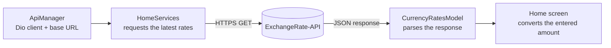

<div align="center">

<picture>
  <source media="(prefers-color-scheme: dark)" srcset="assets/images/splash_screen_dark.png">
  
</picture>

# Sarraf | صرّاف

**A fast, bilingual currency converter for Android and iOS, built with Flutter.**

Live exchange rates &nbsp;·&nbsp; English & Arabic &nbsp;·&nbsp; Light & dark themes

<p>
  <a href="https://flutter.dev"></a>
  <a href="https://dart.dev"></a>
  
  
  
</p>

**English** &nbsp;|&nbsp; [العربية](README.ar.md)

<sub>
<a href="#overview">Overview</a> ·
<a href="#features">Features</a> ·
<a href="#screenshots">Screenshots</a> ·
<a href="#tech-stack">Tech Stack</a> ·
<a href="#architecture">Architecture</a> ·
<a href="#getting-started">Getting Started</a> ·
<a href="#roadmap">Roadmap</a> ·
<a href="#copyright-and-usage-restrictions">License</a>
</sub>

</div>

---

## Overview

**Sarraf** (Arabic for *money changer*) is a Flutter mobile app that converts between currencies using the [ExchangeRate-API](https://www.exchangerate-api.com/). It is built around one focused flow:

1. Pick the source and target currencies.
2. Enter an amount.
3. Get the converted value, based on the latest available rates.

The app is bilingual, with **English (`en-US`)** and **Arabic (`ar-EG`)**, and ships with light and dark themes. Language and theme can be changed from the Settings screen.

## Features

| | Feature | Details |
|:-:|---|---|
| 💱 | **Live exchange rates** | Latest rates fetched from ExchangeRate-API. |
| 🔁 | **Instant conversion** | Choose a source and a target currency, enter an amount, get the result. |
| 🪙 | **Wide currency catalog** | Currency names, codes, and symbols. |
| 🌍 | **Bilingual UI** | English (`en-US`) and Arabic (`ar-EG`) via `easy_localization`. |
| 🎨 | **Light & dark themes** | Appearance and language are controlled from a dedicated Settings screen. |
| 📱 | **Responsive layout** | Adapts to different screen sizes with `flutter_screenutil_plus`. |
| 🚀 | **Platform-ready branding** | Custom Android and iOS app icons; light, dark, and Android 12+ launch screens. |
| 🛠️ | **Developer-friendly** | Network request logging in debug mode with `pretty_dio_logger`. |

## Screenshots

<div align="center">

| Light launch screen | Dark launch screen |
|:---:|:---:|
|  |  |

</div>

<!--
App screens: add real screenshots to docs/screenshots/ and uncomment this block.

<div align="center">

| Converter (EN) | Converter (AR) | Dark theme | Settings |
|:-:|:-:|:-:|:-:|
|  |  |  |  |

</div>
-->

## Tech Stack

| Area | Technology | Used for |
|---|---|---|
| Framework | Flutter | Cross-platform UI for Android and iOS |
| Language | Dart | Application logic |
| Networking | Dio, `pretty_dio_logger` | HTTP client, and request logging in debug mode |
| Data source | ExchangeRate-API (v6) | Latest exchange rates |
| State & theming | `flutter_bloc` / `bloc` | State management, including theme state in the settings feature |
| Localization | `easy_localization` | English (`en-US`) and Arabic (`ar-EG`) strings |
| Responsive UI | `flutter_screenutil_plus` | Screen-adaptive sizing |
| Graphics | `flutter_svg` | Rendering SVG assets |
| Launch screens | `flutter_native_splash` | Light, dark, and Android 12+ splash configuration |

## Architecture

Sarraf uses a feature-based structure: shared infrastructure lives in `core/`, and each feature owns its data, services, logic, and UI.

```text
lib/
├── core/
│   ├── Network/              # Dio client and network configuration
│   ├── constants/            # API and route constants
│   ├── helpers/              # Shared layout helpers
│   ├── routing/              # Application routes
│   └── theming/              # Colors, typography, and themes
├── feature/
│   ├── home/
│   │   ├── data/             # Currency models and rate conversion
│   │   ├── services/         # Home API service
│   │   └── ui/               # Converter screen and widgets
│   └── settings/
│       ├── logic/            # Theme state management
│       └── ui/               # Settings screen and controls
├── main.dart                 # Application entry point
└── sarraf_app.dart           # Root Material application

assets/
├── images/                   # Splash and image assets
├── svgs/                     # Platform and brand SVG assets
└── translations/             # English and Arabic localization files
```

### Data flow



The default request is equivalent to:

```text
GET https://v6.exchangerate-api.com/v6/<API_KEY>/latest/USD
```

## Getting Started

### Prerequisites

- Flutter SDK with Dart `3.13.1` or later (check the exact constraint in `pubspec.yaml`).
- Android Studio with the Android SDK, for Android builds.
- Xcode and CocoaPods, for iOS builds (macOS only).
- A valid [ExchangeRate-API](https://www.exchangerate-api.com/) key.

Check your local Flutter installation:

```bash
flutter doctor
```

### 1. Clone the repository

```bash
git clone https://github.com/Amr4924/Sarraf.git
cd Sarraf
```

### 2. Install dependencies

```bash
flutter pub get
```

### 3. Configure the API

The API configuration lives in:

```text
lib/core/constants/api_constants.dart
```

The current endpoint uses the `latest/USD` route. Replace the API key with your own before distributing the app.

> [!WARNING]
> API keys embedded in a mobile app can be extracted from a built APK or IPA. For production, restrict the key in the provider dashboard or proxy requests through a secure backend. Never commit private or unrestricted credentials.

### 4. Run the app

```bash
flutter run                    # run on the default device
flutter devices                # list connected devices
flutter run -d <device-id>     # run on a specific device
```

## Build

| Platform | Command | Notes |
|---|---|---|
| Android | `flutter build apk --release` | Output: `build/app/outputs/flutter-apk/app-release.apk`. The release manifest already includes the Internet permission required by the exchange-rate API. |
| iOS | `flutter build ios --release` | macOS only. Before publishing to the App Store, configure signing, bundle identifiers, certificates, and provisioning profiles in Xcode. |

## Quality Checks

```bash
dart format .        # format Dart files
flutter analyze      # static analysis
flutter test         # run the test suite
```

## Localization

Translations live in:

```text
assets/translations/en-US.json
assets/translations/ar-EG.json
```

To add a new localized string:

1. Add the key to **both** translation files.
2. Use the same key in the widget with `tr(...)`.
3. Verify both locales from the Settings screen.

## Roadmap

**Done**

- [x] Live exchange rates from ExchangeRate-API
- [x] Conversion between the selected currencies
- [x] English and Arabic localization
- [x] Light and dark themes with a Settings screen
- [x] Android and iOS app icons and launch screens

**Next**

- [ ] Loading, empty, and error states for rate requests
- [ ] Move API credentials to a safer runtime configuration or a backend proxy
- [ ] Unit tests for response parsing and conversion calculations
- [ ] Widget tests for currency selection, input validation, and theme changes
- [ ] Offline caching for the most recently fetched rates

## Development Workflow

> This repository is proprietary. See [Copyright and Usage Restrictions](#copyright-and-usage-restrictions) before sharing or reusing any part of it.

1. Create a focused feature branch: `git switch -c feature/<short-description>`
2. Keep changes scoped and follow the existing feature-based structure.
3. Run `dart format .`, `flutter analyze`, and the relevant tests.
4. Write a clear commit message describing the user-facing change.
5. Open a pull request with validation steps and screenshots for UI changes.

## Copyright and Usage Restrictions

Copyright (c) 2026 Amr Saad. All rights reserved.

Sarraf, including its source code, application name, visual identity, designs,
user interface, icons, images, translations, documentation, and other included
assets, is proprietary work owned by the copyright holder.

This repository is **not open source** and is **not licensed for commercial use**.
No person or organization may, without prior written permission from the
copyright holder:

- use the project or any part of it for commercial purposes;
- copy, reproduce, modify, adapt, or create derivative works;
- publish, redistribute, sublicense, sell, or include it in another product;
- use the Sarraf name, branding, icons, designs, or assets;
- use the source code or assets in a paid service, application, or product.

Personal, educational, and internal evaluation use is allowed only with
appropriate attribution and only if it does not involve commercial
distribution or monetization. This permission does not transfer ownership or
grant any license to publish or redistribute the project.

For any commercial use, redistribution, partnership, licensing request, or other
permission, contact the copyright holder and obtain explicit written approval
before using the project:

- **Copyright holder:** Amr Saad ([@Amr4924](https://github.com/Amr4924))
- **Permission required:** Yes, for any commercial use or redistribution

No rights are granted except those explicitly stated above.

---

<div align="center">
  <sub>Built with Flutter for fast, simple currency conversion.</sub>
</div>