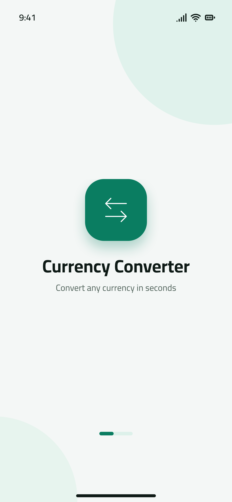
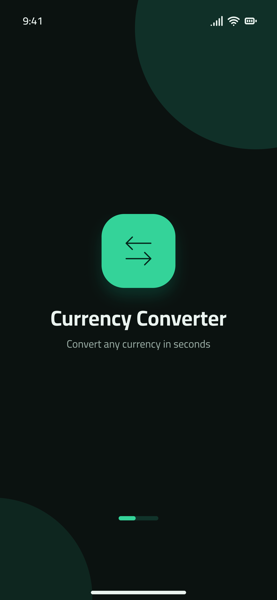
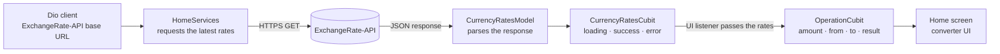
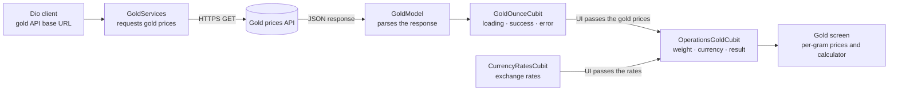

<div align="center">

<picture>
  <source media="(prefers-color-scheme: dark)" srcset="assets/images/splash_screen_dark.png">
  
</picture>

# Sarraf | صرّاف

**A fast, bilingual currency converter with gold prices for Android and iOS, built with Flutter.**

Currency conversion &nbsp;·&nbsp; Gold prices &nbsp;·&nbsp; English & Arabic &nbsp;·&nbsp; Light & dark themes

<p>
  <a href="https://flutter.dev"></a>
  <a href="https://dart.dev"></a>
  
  
  
</p>

**English** &nbsp;|&nbsp; [العربية](README.ar.md)

<sub>
<a href="#overview">Overview</a> ·
<a href="#features">Features</a> ·
<a href="#screenshots">Screenshots</a> ·
<a href="#tech-stack">Tech Stack</a> ·
<a href="#architecture">Architecture</a> ·
<a href="#data-sources">Data Sources</a> ·
<a href="#getting-started">Getting Started</a> ·
<a href="#roadmap">Roadmap</a> ·
<a href="#copyright-and-usage-restrictions">License</a>
</sub>

</div>

---

## Overview

**Sarraf** (Arabic for *money changer*) is a Flutter mobile app with two tools:

1. **Currency converter:** pick a source and a target currency, enter an amount, and see the converted value as you type, based on the latest rates available from [ExchangeRate-API](https://www.exchangerate-api.com/).
2. **Gold prices:** see the price per gram of 24K, 22K, 21K, and 18K gold in the currency you choose, and estimate the value of a given weight of 21K gold.

The app is bilingual, with **English (`en-US`)** and **Arabic (`ar-EG`)**, and ships with light and dark themes. Language and theme can be changed from the Settings screen.

## Features

| | Feature | Details |
|:-:|---|---|
| 💱 | **Currency converter** | Convert between 160+ currencies. The result updates as you type, and the swap button reverses the currency pair. |
| 📈 | **Exchange rates** | Rates are fetched from ExchangeRate-API when the app starts, and are as fresh as the provider's latest update. |
| 🥇 | **Gold prices** | Price per gram for 24K, 22K, 21K, and 18K gold, shown in any supported currency. |
| 🧮 | **Gold calculator** | Enter a weight in grams to estimate the value of 21K gold in the selected currency. |
| ⏳ | **Loading and error handling** | A loading indicator for rates and shimmer placeholders for gold prices. An error dialog with retry for exchange rates, and a retry button for gold prices. |
| 🌍 | **Bilingual UI** | English (`en-US`) and Arabic (`ar-EG`) via `easy_localization`. |
| 🎨 | **Light & dark themes** | Appearance and language are controlled from a dedicated Settings screen. |
| 📱 | **Responsive layout** | Adapts to different screen sizes with `flutter_screenutil_plus`. |
| 🚀 | **Platform-ready branding** | Custom Android and iOS app icons; light, dark, and Android 12+ launch screens. |
| 🛠️ | **Developer-friendly** | Network request logging in debug mode with `pretty_dio_logger`. |

## Screenshots

<div align="center">

| Light launch screen | Dark launch screen |
|:---:|:---:|
|  |  |

</div>

<!--
App screens: add real screenshots to docs/screenshots/ and uncomment this block.

<div align="center">

| Converter (EN) | Converter (AR) | Gold prices | Dark theme | Settings |
|:-:|:-:|:-:|:-:|:-:|
|  |  |  |  |  |

</div>
-->

## Tech Stack

| Area | Technology | Used for |
|---|---|---|
| Framework | Flutter | Cross-platform UI for Android and iOS |
| Language | Dart | Application logic |
| Networking | Dio, `pretty_dio_logger` | HTTP clients, and request logging in debug mode |
| Data sources | ExchangeRate-API (v6), egypt-gold-price.com API | Exchange rates and gold prices |
| State management | `flutter_bloc` / `bloc` | Cubits for exchange rates, conversion, gold prices, the gold calculator, and the theme |
| Localization | `easy_localization` | English (`en-US`) and Arabic (`ar-EG`) strings, plus number formatting through `intl` |
| Responsive UI | `flutter_screenutil_plus` | Screen-adaptive sizing |
| Typography | `google_fonts` | Cairo typeface |
| Graphics | `flutter_svg` | Rendering SVG assets |
| Feedback UI | `awesome_dialog`, `shimmer` | Error dialog and loading placeholders |
| Launch screens | `flutter_native_splash` | Light, dark, and Android 12+ splash configuration |

## Architecture

Sarraf uses a feature-based structure: shared infrastructure lives in `core/`, and each feature owns its data, logic, and UI.

```text
lib/
├── core/
│   ├── Network/              # Dio clients for the exchange-rate and gold APIs
│   ├── constants/            # API base URLs and endpoints
│   ├── helpers/              # Shared layout helpers
│   ├── models/               # Shared models (currency catalog)
│   ├── routing/              # Application routes
│   ├── theming/              # Colors, typography, and themes
│   └── widgets/              # Shared widgets (currency field, numeric text field)
├── feature/
│   ├── home/
│   │   ├── data/             # Exchange-rate model and API service
│   │   ├── logic/            # Cubits: fetching rates, conversion state
│   │   └── ui/               # Converter screen and widgets
│   ├── gold/
│   │   ├── data/             # Gold models, karat list, and API service
│   │   ├── logic/            # Cubits: fetching gold prices, calculator state
│   │   └── ui/               # Gold screen, calculator, karat list, shimmer
│   └── settings/
│       ├── logic/            # Theme state management
│       └── ui/               # Settings screen and controls
├── main.dart                 # Application entry point and Cubit providers
└── sarraf_app.dart           # Root Material application

assets/
├── images/                   # Splash and image assets
├── svgs/                     # Platform, theme-preview, and brand SVG assets
└── translations/             # English and Arabic localization files
```

### State management

All Cubits are provided app-wide in `main.dart`.

| Cubit | Responsibility |
|---|---|
| `CurrencyRatesCubit` | Fetches exchange rates (initial, loading, success, error). |
| `OperationCubit` | Holds the amount, the source and target currencies, and the converted result. Handles the swap. |
| `GoldOunceCubit` | Fetches gold prices (initial, loading, success, error). |
| `OperationsGoldCubit` | Holds the weight and the selected currency, and derives the gold value and the per-gram prices. |
| `ThemeCubit` | Holds the selected theme mode. |

### Data flow

Currency conversion:



Gold prices:



The default requests are equivalent to:

```text
GET https://v6.exchangerate-api.com/v6/<API_KEY>/latest/USD
GET https://www.egypt-gold-price.com/api/prices.php
```

### How gold prices are calculated

For a karat `K` and the selected currency, the price per gram is:

```text
price per gram = (gold ounce price in USD ÷ 31.1035) × (K ÷ 24) × (USD → selected currency rate)
```

`31.1035` is the number of grams in a troy ounce. The calculator multiplies the 21K price per gram by the weight you enter. Only the ounce price in USD from the gold API response is used.

> [!NOTE]
> These values are estimates derived from the ounce price. They do not include making charges, taxes, or dealer premiums, and they can differ from the prices quoted by jewelers.

## Data Sources

| Data | Provider | Notes |
|---|---|---|
| Exchange rates | [ExchangeRate-API](https://www.exchangerate-api.com/) (v6) | Requires an API key. Rates are as fresh as the provider's latest update. |
| Gold prices | [egypt-gold-price.com](https://www.egypt-gold-price.com/) API | Called by the app without an API key. |

> [!NOTE]
> Exchange rates and gold values shown in the app are informational estimates, not financial advice, and may differ from bank, exchange-office, or jeweler prices. The data comes from third-party providers, so availability, accuracy, and usage terms depend on them.

## Getting Started

### Prerequisites

- Flutter SDK with Dart `3.13.1` or later (check the exact constraint in `pubspec.yaml`).
- Android Studio with the Android SDK, for Android builds.
- Xcode and CocoaPods, for iOS builds (macOS only).
- A valid [ExchangeRate-API](https://www.exchangerate-api.com/) key. The gold API used by the app does not need one.

Check your local Flutter installation:

```bash
flutter doctor
```

### 1. Clone the repository

```bash
git clone https://github.com/Amr4924/Sarraf.git
cd Sarraf
```

### 2. Install dependencies

```bash
flutter pub get
```

### 3. Configure the APIs

The API configuration lives in:

```text
lib/core/constants/api_constants.dart    # base URLs for exchange rates and gold prices
lib/core/constants/api_endpoint.dart     # endpoints: base currency and the gold prices route
```

Replace the key segment of `rateBaseUrl` with your own ExchangeRate-API key:

```dart
class ApiConstants {
  static final String rateBaseUrl =
      "https://v6.exchangerate-api.com/v6/<YOUR_API_KEY>/latest/";
  static final String goldBaseUrl = "https://www.egypt-gold-price.com/api/";
}
```

The rates request uses the `latest/USD` route, and the gold request calls `prices.php`.

> [!WARNING]
> API keys embedded in a mobile app can be extracted from a built APK or IPA. For production, restrict the key in the provider dashboard or proxy requests through a secure backend. Never commit a private or unrestricted key to a public repository.

### 4. Run the app

```bash
flutter run                    # run on the default device
flutter devices                # list connected devices
flutter run -d <device-id>     # run on a specific device
```

## Build

| Platform | Command | Notes |
|---|---|---|
| Android | `flutter build apk --release` | Output: `build/app/outputs/flutter-apk/app-release.apk`. The release manifest already includes the Internet permission required by the data APIs. |
| iOS | `flutter build ios --release` | macOS only. Before publishing to the App Store, configure signing, bundle identifiers, certificates, and provisioning profiles in Xcode. |

## Quality Checks

```bash
dart format .        # format Dart files
flutter analyze      # static analysis
```

> [!NOTE]
> The repository still contains Flutter's default template test, which does not match this app. Replacing it with real tests is on the [roadmap](#roadmap), so `flutter test` is not listed here yet.

## Localization

Translations live in:

```text
assets/translations/en-US.json
assets/translations/ar-EG.json
```

To add a new localized string:

1. Add the key to **both** translation files.
2. Use the same key in the widget with `tr(...)`.
3. Verify both locales from the Settings screen.

## Known Limitations

- An internet connection is required. Rates and gold prices are not cached yet.
- The gold calculator values 21K gold only.
- The selected theme is not saved between launches.

## Roadmap

**Done**

- [x] Exchange rates from ExchangeRate-API, and conversion between any two currencies
- [x] Conversion as you type, with a swap button
- [x] Loading and error states with retry for exchange rates and gold prices
- [x] Gold prices per karat, and a gold value calculator
- [x] Cubit-based state management across the features
- [x] English and Arabic localization
- [x] Light and dark themes with a Settings screen
- [x] Android and iOS app icons and launch screens

**Next**

- [ ] Move API credentials to a safer runtime configuration or a backend proxy
- [ ] Unit tests for response parsing, conversion, and gold calculations
- [ ] Widget tests for currency selection, input, and theme changes
- [ ] Offline caching for the most recently fetched rates and gold prices
- [ ] Show the provider's last update time for rates and gold prices
- [ ] Karat selection in the gold calculator
- [ ] Persist the selected theme between launches
- [ ] Search in the currency picker

## Development Workflow

> This repository is proprietary. See [Copyright and Usage Restrictions](#copyright-and-usage-restrictions) before sharing or reusing any part of it.

1. Create a focused branch from `development`: `git switch -c feature/<short-description>` (or `fix/…`, `refactor/…`).
2. Keep changes scoped and follow the existing feature-based structure.
3. Run `dart format .` and `flutter analyze`, and test the affected flows on both languages and both themes.
4. Write a clear commit message following [Conventional Commits](https://www.conventionalcommits.org/), for example `feat(gold): add karat selection`.
5. Open a pull request into `development` with validation steps and screenshots for UI changes. Changes are promoted through `development` → `staging` → `master`.

## Copyright and Usage Restrictions

Copyright (c) 2026 Amr Saad. All rights reserved.

Sarraf, including its source code, application name, visual identity, designs,
user interface, icons, images, translations, documentation, and other included
assets, is proprietary work owned by the copyright holder.

This repository is **not open source** and is **not licensed for commercial use**.
No person or organization may, without prior written permission from the
copyright holder:

- use the project or any part of it for commercial purposes;
- copy, reproduce, modify, adapt, or create derivative works;
- publish, redistribute, sublicense, sell, or include it in another product;
- use the Sarraf name, branding, icons, designs, or assets;
- use the source code or assets in a paid service, application, or product.

Personal, educational, and internal evaluation use is allowed only with
appropriate attribution and only if it does not involve commercial
distribution or monetization. This permission does not transfer ownership or
grant any license to publish or redistribute the project.

For any commercial use, redistribution, partnership, licensing request, or other
permission, contact the copyright holder and obtain explicit written approval
before using the project:

- **Copyright holder:** Amr Saad ([@Amr4924](https://github.com/Amr4924))
- **Permission required:** Yes, for any commercial use or redistribution

No rights are granted except those explicitly stated above.

---

<div align="center">
  <sub>Built with Flutter for fast, simple currency conversion and gold prices.</sub>
</div>